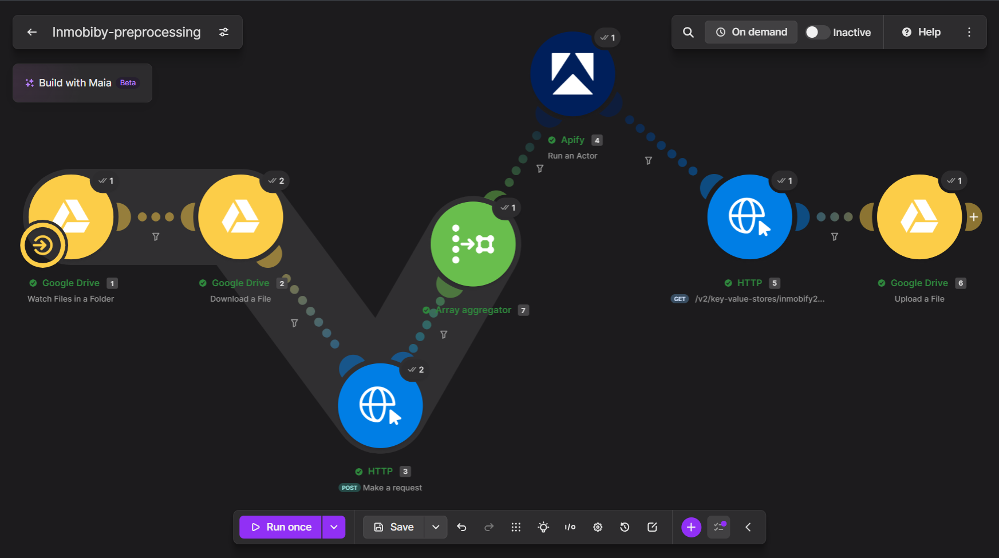

# 🏢 Inmobify — Inteligencia Geoespacial y Valuación del Mercado Inmobiliario Comercial (Rosario)

**Samsung Innovation Campus (SIC) — Capstone Project | Entrega 1: Analytics (ETL + EDA)**

---

## 👥 Equipo de Trabajo

* **Nombre del Grupo:** Inmobify
* **Nombre del Proyecto:** Inmobify — Pipeline Automatizado de Datos Inmobiliarios y Entorno Comercial en Rosario
* **Integrantes:**
  * Francisco Lovatti
  * Matias Radice

---

## 🔗 Recursos Asociados (Producción y Entregables)

| Recurso | Descripción | Enlace |
| :--- | :--- | :--- |
| **Dashboard Interactivo** | Aplicación web en Streamlit Cloud conectada en vivo al Key-Value Store de Apify | [Inmobify.streamlit.app](https://inmobify.streamlit.app) |
| **Orquestación ETL (Make)** | Escenario automatizado (`Google Drive` $\leftrightarrow$ `Apify` $\rightarrow$ `Google Drive`) | [Make/Inmobify-preprocessing](https://us2.make.com/public/shared-scenario/xX9odpDyFj5/inmobiby-preprocessing) |
| **Datasets (Crudos y Limpio)** | Carpeta compartida con insumos crudos y `dataset_inmobiliario_completo_rosario.csv` | [Crudos](https://drive.google.com/drive/folders/1ocF57VMkUzPyvAdw0Y-cl2pmDxBNS3VL?usp=drive_link) [Resultados](https://drive.google.com/drive/folders/1ghXKHo9peCMlSjbvKN7nSISs9E2WdDcN?usp=drive_link) |

<p align="center"></p>

---

## ⚙️ Arquitectura del Pipeline End-to-End

El flujo de datos integra **Google Drive**, **Make**, **Apify** y **Streamlit** en una arquitectura desacoplada y reproducible:

```text
[Google Drive: /Inmobify-preprocessing]
  ├── raw_zonaprop_rosario.csv (1.079 avisos)
  └── maestro_comercios_rosario.csv (2.100 comercios)
            │
            ▼  (Make: Watch Files + Download + HTTP PUT + Array Aggregator)
[Apify Key-Value Store: inmobify-storage]
            │
            ▼  (Make: Run an Actor — inmobify2/inmobify-preprocessing)
[Actor Python ETL + Feature Engineering + EDA]
  ├── Limpieza, normalización ARS/USD y filtrado geográfico (477 propiedades)
  ├── Cálculo Haversine en radios de 200m / 350m y distancia a polos comerciales
  └── Generación de KPIs de mercado por barrio y tipo de inmueble (33 features)
            │
            ├──────────────────────────────┐
            ▼                              ▼
[Apify Key-Value Store]          [Make: HTTP GET + Upload]
  └── Consumo en vivo vía SDK      └── Respaldo en Google Drive (/Inmobify-preprocessing-results)
            │
            ▼
[Dashboard Interactivo en Streamlit Cloud]

```

---

## 🎯 Fenómeno Estudiado, Selección de Features y Métricas de Negocio

### 1. Problemática y Targets

En el mercado de alquileres comerciales de Rosario (locales y oficinas), los precios publicados presentan alta dispersión dentro de un mismo barrio debido a factores micro-geográficos (tráfico peatonal, concentración de rubros y cercanía a polos) y estructurales (economía de escala por superficie y expensas).

* **Target Principal (Regresión):** `log1p(precio_usd)` — canon locativo mensual en dólares (mediana global: **USD 750/mes** | **USD 8,06/m²/mes**).
* **Target Secundario (Clasificación / Negocio):** `posicion_mercado_barrio` e `indice_precio_relativo_barrio` ($\text{IPR}$), identificando propiedades con $\text{IPR} < 0,85$ (**15 % o más por debajo** de la mediana comparable de su barrio y tipo de inmueble) como **Oportunidades**.

### 2. Selección de Features (4 Lineales + 5 No Lineales)

| Feature | Tipo | Evidencia Estadística | Rol en el Modelo y Negocio |
| --- | --- | --- | --- |
| `log_superficie_m2` | **Lineal (1/4)** | $r = +0,773$ con `precio_usd` | Elasticidad log-log y economía de escala ($r = -0,353$ con `precio_m2_usd`) |
| `superficie_m2` | **Lineal (2/4)** | $r = +0,741$ con `precio_usd` | Escala física directa del inmueble |
| `es_gran_superficie` | **Lineal (3/4)** | $r = +0,689$ con `precio_usd` | Salto estructural en inmuebles $> 200\text{ m}^2$ |
| `tiene_expensas` | **Lineal (4/4)** | $r = -0,315$ con `precio_usd` | Ajuste del canon neto por carga de expensas |
| `barrio` + `tipo_inmueble` | **No Lineal (1/5)** | Mediana USD 6,88 a 14,20/m² | Prima por categoría edilicia y vidriera comercial |
| `log_trafico_resenas_200m` | **No Lineal (2/5)** | $r = -0,54$ dist. Monumento | Proxy no lineal de flujo peatonal real en 200 m |
| `densidad_comercial_200m` | **No Lineal (3/5)** | 0 a 71 comercios en 200 m | Concentración de actividad comercial inmediata |
| `diversidad_rubros_200m` | **No Lineal (4/5)** | 0 a 36 rubros distintos | Mix comercial y sinergia de atracción de público |
| `dist_polo_mas_cercano_m` | **No Lineal (5/5)** | Mín. Monumento/Pichincha/Pellegrini | Gradiente espacial de centralidad urbana |

### 3. Métricas de Evaluación y KPIs

Dada la fuerte **asimetría positiva (cola derecha)** de los alquileres mensuales y del tráfico comercial, se descartó el RMSE para evitar sesgo por locales de gran metraje y se establecieron:

* **MAPE $\le 18\%$** (Error Porcentual Absoluto Medio): evalúa con igual equidad locales chicos de alta rotación y grandes superficies.
* **MAE $\le \text{USD } 2,00/\text{m}^2$**: error absoluto medio en moneda dura interpretable para tasaciones inmobiliarias.
* **KPIs en Dashboard:** Mediana Alquiler ($\text{USD } 8,06/\text{m}^2/\text{mes}$), Tasa de Oportunidades Barriales ($\text{IPR} < 0,85$), Ahorro Mediano frente a la Mediana Barrial y **Oportunidades Calificadas** ($\text{IPR} < 0,85$ + alta densidad comercial en 200 m).

---

## 📂 Estructura y Contenido del Repositorio

```text
inmobify-preprocessing/
├── .actor/
│   ├── actor.json              # Metadatos y configuración de ejecución del Actor en Apify
│   └── input_schema.json       # Esquema de parámetros de entrada (kv_store_name, claves CSV, tipo_cambio_usd)
├── src/
│   ├── __init__.py             # Inicialización del paquete fuente
│   ├── main.py                 # Punto de entrada asíncrono del Actor (lectura/escritura en Apify Key-Value Store)
│   ├── limpieza.py             # Normalización ARS/USD, filtrado geográfico de Rosario, imputación y remoción de outliers
│   ├── features.py             # Ingeniería de atributos: distancias Haversine (200m/350m), polos comerciales e IPR barrial
│   └── eda_tablas.py           # Generación de tablas resumen agregadas por barrio, tipo de inmueble y segmento
├── dashboard/
│   ├── app.py                  # Aplicación interactiva en Streamlit (Mapa geoespacial, EDA, Correlaciones, Métricas/KPIs y Tabla)
├── Dockerfile                  # Imagen base Python 3.11 para despliegue serverless en Apify
├── requirements.txt            # Dependencias del Actor ETL (apify, pandas, numpy, scipy)
└── README.md                   # Documentación técnica del proyecto

```

---

## 🚀 Ejecución Local

### 1. Dashboard en Streamlit

```bash
pip install -r dashboard/requirements.txt
export APIFY_TOKEN="apify_api_tu_token"
streamlit run dashboard/app.py

```

### 2. Actor ETL + Feature Engineering

```bash
pip install -r requirements.txt
apify run

```